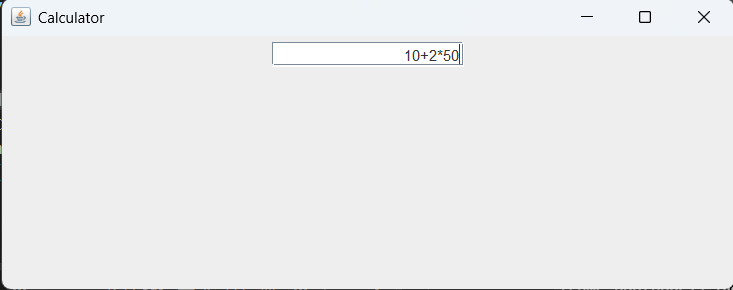
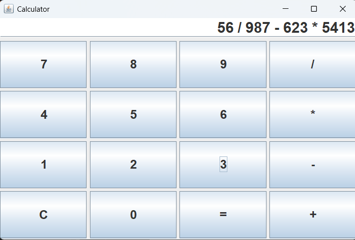

Journal 

hi everyone 

please go downward for app video demo (incase if there is  any problem for reviwer to open the app .can check how my app work)

1. create a basic window and add input 

2. finally added the numbers and operators 

3. added logic for calculation and change the color of ui 

4. Missed the deadline for the terra, but then I found out about the 3 AM  so I am just gonna submit there instead.

Decided to so something like a scary vibe . Not gonna post pictures yet though don not want to spoil the horror. So far I have just been working on the UI and putting in some creepy visuals, but later on I'll add sound effects too.

5.added so many things 
frames make it creepy 

asset and it credit 
a-Photo by Nong on Unsplash
b-adobe
c-Photo by Robert Zunikoff on Unsplash
e-vedio by Mounir Marley  on pexels
h,click-Panto Man on pixabay

<

.
* here 

https://drive.google.com/drive/folders/1wVgVQqPMnV1laPUwwzoxF1pa5vk0iOtQ?usp=sharing