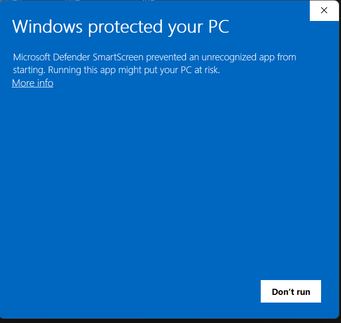
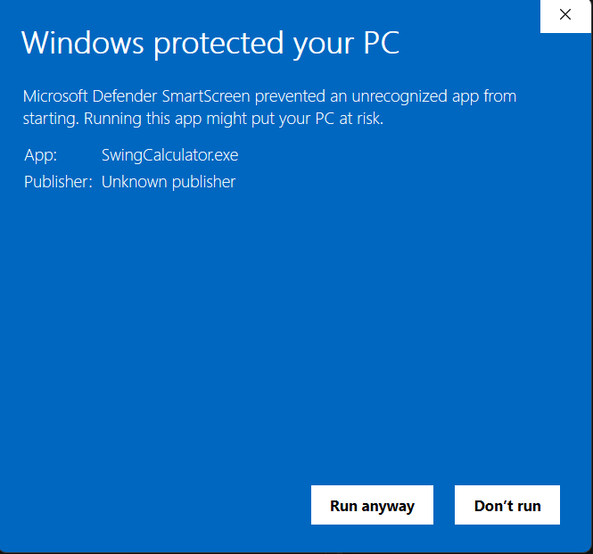
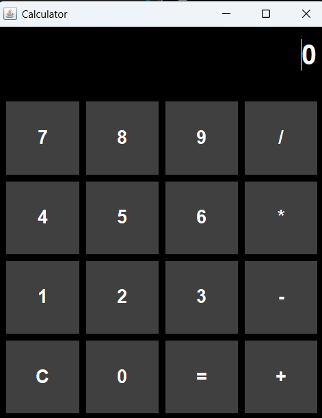

# Dcalc    

**calculator, until you press =**

Dcalc is a Java Swing desktop application .with some scary things,  Perform a calculation and discover what happens next.
DDddddddddddddddddddddddd

## How to Download and run 
for windows 

so the simpleset way without any java download requirement is exe version .

1. Download zip from relases page the exe which i mention in the realses page.

2. unzip / extract the zip.

3. They double-click SwingCalculator.exe to run the app immediately.

note- sometime it can ask this permision so click more info and click run anyaway .

 Now there is one more way to run but i prefer exe one .so this one is jar version 

 so i have 
java version "24.0.2" 2025-07-15
Java(TM) SE Runtime Environment (build 24.0.2+12-54)
Java HotSpot(TM) 64-Bit Server VM (build 24.0.2+12-54, mixed mode, sharing)

1. first download the zip from the realses page the one without exe.
2. extract the zip 
3. double click .jar file .it will run 

## Features

All Basic feature available in Calculator add, sub, multiply and divide.

In horror added image sound effects video and audio . i can not show you the all screenshoot . see for yourself .

* Scary Things 

 

## Technologies Used

- Java
- Java Swing
- JLayer for MP3 playback
- Java AWT

## Project Purpose
Dcalc started out as a  Java Swing project to learn GUI development and event handling. and i found out  3 AM ysws, I decided to change regular calculator  gave it a creepy horror vibe instead. Really happy with how it turned out.

:>>>> <<<<<;

## Assets and it credit 
a-Photo by Nong on Unsplash

b-adobe

c-Photo by Robert Zunikoff on Unsplash

e-vedio by Mounir Marley  on pexels

h,click-Panto Man on pixabay

here a,b,c,e,click are file name .

 ( demo vedio)
https://drive.google.com/drive/folders/1wVgVQqPMnV1laPUwwzoxF1pa5vk0iOtQ?usp=drive_link